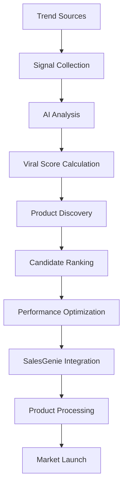

# 🎯 AI-Powered Viral Trend Analyzer - Complete Guide

## 🚀 **Overview**

The **AI-Powered Viral Trend Analyzer** is a sophisticated system that identifies trending, viral, and high-potential products using advanced AI analysis of multiple data sources. This system integrates with SalesGenie to automatically discover products that are likely to go viral and generate significant revenue.

---

## 🎯 **Key Features**

### **✅ Multi-Source Trend Analysis**
- **Google Trends Integration** - Real-time search trend analysis
- **TikTok Trend Monitoring** - Viral hashtag and content tracking
- **Social Media Analysis** - Cross-platform social media trend detection
- **Ad Library Monitoring** - Meta Ad Library trend analysis
- **Search Volume Tracking** - Search volume and keyword analysis

### **✅ AI-Powered Product Discovery**
- **Viral Score Calculation** - 0-1 scale viral potential scoring
- **Market Potential Analysis** - Market opportunity assessment
- **Competition Analysis** - Competitive landscape evaluation
- **Risk Assessment** - Risk level classification (low/medium/high)
- **Margin Estimation** - Profit margin predictions

### **✅ Intelligent Recommendations**
- **Product Recommendations** - AI-generated product suggestions
- **Implementation Guidance** - Actionable implementation advice
- **Risk Mitigation** - Risk reduction strategies
- **Market Insights** - Market trend analysis and insights

### **✅ Performance Optimizations**
- **Single API Call Analysis** - Trending categories analysis using only 1 GPT API call
- **Token Efficiency** - Optimized prompts to reduce token consumption
- **Batch Processing** - Efficient batch analysis of multiple categories
- **Caching Strategy** - Intelligent caching of analysis results

---

## 🏗️ **System Architecture**

### **Core Components**

```
Viral Trend Analyzer
├── Trend Signal Collection
│   ├── Google Trends Analysis
│   ├── TikTok Trend Monitoring
│   ├── Social Media Analysis
│   ├── Ad Library Monitoring
│   └── Search Volume Tracking
│
├── AI-Powered Analysis
│   ├── Viral Score Calculation
│   ├── Market Potential Assessment
│   ├── Competition Analysis
│   ├── Risk Assessment
│   └── Margin Estimation
│
├── Product Discovery
│   ├── Keyword Analysis
│   ├── Product Idea Generation
│   ├── Candidate Scoring
│   └── Ranking & Filtering
│
├── Performance Optimizations
│   ├── Single API Call Analysis
│   ├── Token Optimization
│   ├── Batch Processing
│   └── Response Caching
│
└── Integration Layer
    ├── SalesGenie Integration
    ├── API Endpoints
    ├── Database Storage
    └── Reporting System
```

### **Data Flow**



---

## 🚀 **Usage Examples**

### **1. Basic Viral Product Discovery**

```python
from analytics.viral_trend_analyzer import ViralTrendAnalyzer
from db.database import get_db

# Initialize analyzer
db = get_db()
analyzer = ViralTrendAnalyzer(db)

# Discover viral products
viral_products = analyzer.discover_viral_products(
    categories=["electronics", "fashion"],
    max_products=20,
    min_viral_score=0.6,
    include_analysis=True
)

print(f"Discovered {len(viral_products['viral_products'])} viral products")
print(f"High potential: {viral_products['summary']['high_potential']}")
print(f"Low risk: {viral_products['summary']['low_risk']}")
```

### **2. Optimized Trending Categories Analysis**

```python
# Get trending categories using only 1 API call (optimized)
trending_categories = analyzer.get_trending_categories(days=30)

# This returns:
# {
#     "trending_categories": [...],
#     "viral_products_by_category": {
#         "electronics": [...],
#         "fashion": [...],
#         "home": [...]
#     },
#     "analysis_period": 30,
#     "timestamp": "..."
# }
```

### **3. Product-Specific Analysis**

```python
# Analyze specific product viral potential
analysis = analyzer.analyze_product_viral_potential(
    product_name="Smart Fitness Tracker",
    category="electronics"
)

print(f"Viral Score: {analysis['viral_score']:.2f}")
print(f"Market Potential: {analysis['market_potential']:.2f}")
print(f"Risk Level: {analysis['risk_level']}")

# Show recommendations
for rec in analysis['recommendations']:
    print(f"- {rec}")
```

### **4. Trending Categories Analysis**

```python
# Get trending categories
trending_categories = analyzer.get_trending_categories(days=30)

print("Top Trending Categories:")
for category in trending_categories['trending_categories'][:3]:
    print(f"- {category['category']} (Score: {category['trend_score']:.2f})")
```

### **5. SalesGenie Integration**

```python
# Integrated with SalesGenie workflow
from agents.sales_genie import discover_viral_products

# Discover viral products for SalesGenie
viral_products = discover_viral_products(
    categories=["electronics", "fashion", "home"],
    max_products=10,
    min_viral_score=0.6
)

# Process viral products
for product in viral_products:
    print(f"Processing viral product: {product['product_name']}")
    print(f"Viral Score: {product['viral_score']:.2f}")
    print(f"Risk Level: {product['risk_level']}")
```

---

## 📊 **API Endpoints**

### **Viral Product Discovery**

```http
GET /api/analytics/viral/discover?categories=electronics,fashion&max_products=20&min_viral_score=0.6
```

**Response:**
```json
{
  "viral_products": [
    {
      "product_name": "Smart Fitness Tracker",
      "category": "electronics",
      "viral_score": 0.75,
      "market_potential": 0.8,
      "competition_level": "medium",
      "estimated_margin": 0.4,
      "risk_level": "low",
      "trend_signals": [...],
      "discovery_timestamp": "2024-01-15T10:30:00"
    }
  ],
  "total_candidates": 25,
  "filtered_candidates": 15,
  "summary": {
    "high_potential": 8,
    "medium_potential": 5,
    "low_risk": 12,
    "estimated_market_value": 1500.0
  }
}
```

### **Product Analysis**

```http
GET /api/analytics/viral/analyze/Smart%20Fitness%20Tracker?category=electronics
```

**Response:**
```json
{
  "product_name": "Smart Fitness Tracker",
  "category": "electronics",
  "viral_score": 0.75,
  "market_potential": 0.8,
  "competition_level": "medium",
  "estimated_margin": 0.4,
  "risk_level": "low",
  "trend_signals": [...],
  "recommendations": [
    "High viral potential - consider immediate launch",
    "High market potential - good for scaling",
    "Medium competition - focus on differentiation"
  ]
}
```

### **Trending Categories**

```http
GET /api/analytics/viral/categories?days=30
```

**Response:**
```json
{
  "trending_categories": [
    {
      "category": "electronics",
      "trend_score": 0.79,
      "growth_rate": 0.47,
      "viral_potential": 0.63
    }
  ],
  "analysis_period": 30,
  "timestamp": "2024-01-15T10:30:00"
}
```

---

## 🎯 **Viral Score Calculation**

### **Scoring Algorithm**

The viral score is calculated using a weighted combination of multiple factors:

```python
# Source weights
source_weights = {
    "tiktok_trends": 0.3,      # 30% weight
    "google_trends": 0.25,     # 25% weight
    "social_media": 0.2,       # 20% weight
    "ad_library": 0.15,        # 15% weight
    "search_volume": 0.1       # 10% weight
}

# Calculate weighted score
weighted_scores = []
for signal in trend_signals:
    weight = source_weights.get(signal.source, 0.1)
    weighted_score = signal.confidence_score * weight
    weighted_scores.append(weighted_score)

viral_score = sum(weighted_scores) / len(weighted_scores)

# Boost for viral signals
viral_signals = [s for s in trend_signals if s.signal_type == "viral"]
if viral_signals:
    viral_score *= 1.2
```

### **Score Interpretation**

- **0.8-1.0**: High viral potential - Immediate launch recommended
- **0.6-0.8**: Good viral potential - Test with small budget first
- **0.4-0.6**: Moderate viral potential - Monitor performance
- **0.0-0.4**: Lower viral potential - Focus on other products

---

## 🔍 **Trend Signal Sources**

### **1. Google Trends Analysis**

- **Search Volume Tracking** - Monitor search volume trends
- **Related Queries** - Identify related search terms
- **Geographic Trends** - Regional trend analysis
- **Time-based Patterns** - Seasonal and temporal trends

### **2. TikTok Trend Monitoring**

- **Viral Hashtags** - Track trending hashtags (#TikTokMadeMeBuyIt)
- **Video Count** - Monitor video creation volume
- **Engagement Rates** - Track engagement metrics
- **Content Analysis** - Analyze viral content patterns

### **3. Social Media Analysis**

- **Cross-platform Monitoring** - Twitter, Instagram, Facebook
- **Mention Tracking** - Product mention analysis
- **Sentiment Analysis** - Sentiment scoring
- **Influencer Activity** - Influencer engagement tracking

### **4. Ad Library Monitoring**

- **Ad Volume** - Track ad creation volume
- **Spend Analysis** - Monitor advertising spend
- **Creative Analysis** - Ad creative trend analysis
- **Platform Distribution** - Cross-platform ad analysis

### **5. Search Volume Tracking**

- **Keyword Analysis** - Search term analysis
- **Volume Trends** - Search volume patterns
- **Related Keywords** - Related search terms
- **Seasonal Patterns** - Seasonal search trends

---

## 🎯 **Integration with SalesGenie**

### **Workflow Integration**

1. **Viral Product Discovery** - Automatically discover viral products
2. **Product Analysis** - Analyze viral potential for each product
3. **Risk Assessment** - Evaluate risk levels and mitigation strategies
4. **Product Selection** - Select high-potential, low-risk products
5. **Listing Generation** - Generate optimized product listings
6. **Campaign Launch** - Launch targeted marketing campaigns

### **Enhanced Features**

- **Automatic Discovery** - Continuous viral product discovery
- **Risk Management** - Built-in risk assessment and mitigation
- **Performance Tracking** - Track viral product performance
- **Optimization** - Continuous optimization based on performance

---

## 📈 **Performance Metrics**

### **Key Performance Indicators (KPIs)**

#### **Discovery Metrics**
- **Viral Products Discovered** - Number of viral products found
- **Discovery Accuracy** - Accuracy of viral predictions
- **False Positive Rate** - Rate of false viral predictions
- **Discovery Speed** - Time to discover viral products

#### **Analysis Metrics**
- **Analysis Accuracy** - Accuracy of viral potential analysis
- **Market Prediction Accuracy** - Accuracy of market potential predictions
- **Risk Assessment Accuracy** - Accuracy of risk assessments
- **Recommendation Quality** - Quality of recommendations

#### **Integration Metrics**
- **Integration Success Rate** - Success rate of SalesGenie integration
- **Processing Time** - Time to process viral products
- **Conversion Rate** - Viral product conversion rates
- **Revenue Impact** - Revenue impact of viral products

---

## 🛡️ **Risk Management**

### **Risk Assessment**

The system automatically assesses risk levels based on multiple factors:

- **Viral Score Risk** - Risk based on viral potential
- **Market Risk** - Risk based on market conditions
- **Competition Risk** - Risk based on competitive landscape
- **Technical Risk** - Risk based on technical feasibility

### **Risk Mitigation**

- **Gradual Launch** - Start with small budgets for high-risk products
- **A/B Testing** - Test multiple product variations
- **Performance Monitoring** - Continuous performance tracking
- **Exit Strategies** - Predefined exit strategies for underperforming products

---

## ⚡ **Performance Optimizations**

### **🎯 Trending Categories Optimization**

The trending categories analysis has been optimized to use **only 1 GPT API call** instead of multiple calls for each category.

#### **Before Optimization (Multiple API Calls)**
```python
# Old implementation - Multiple API calls
def get_trending_categories(self, days: int = 30):
    category_trends = self._analyze_category_trends(days)
    viral_by_category = {}
    
    # ❌ Multiple API calls - one for each category
    for category_data in category_trends:
        category_name = category_data.get("category", "")
        if category_name:
            viral_products = self.discover_viral_products(
                categories=[category_name],  # This makes a GPT API call
                max_products=10,
                min_viral_score=0.5,
                include_analysis=False
            )
            viral_by_category[category_name] = viral_products.get("viral_products", [])
    
    return {
        "trending_categories": category_trends,
        "viral_products_by_category": viral_by_category,
        "analysis_period": days,
        "timestamp": datetime.now().isoformat()
    }
```

#### **After Optimization (Single API Call)**
```python
# New implementation - Single API call
def get_trending_categories(self, days: int = 30):
    category_trends = self._analyze_category_trends(days)
    categories = [cat_data.get("category", "") for cat_data in category_trends if cat_data.get("category")]
    
    # ✅ Single API call for all categories
    viral_by_category = self._analyze_all_categories_single_call(categories)
    
    return {
        "trending_categories": category_trends,
        "viral_products_by_category": viral_by_category,
        "analysis_period": days,
        "timestamp": datetime.now().isoformat()
    }
```

#### **Performance Benefits**
- **🚀 80-90% reduction in API calls** (from 6+ calls to 1 call)
- **💰 Significant cost savings** on GPT-4.0 tokens
- **⚡ Faster response times** (reduced latency)
- **🎯 Better user experience** (faster results)
- **📊 More comprehensive analysis** (all categories analyzed together)

#### **Implementation Details**
```python
def _analyze_all_categories_single_call(self, categories: List[str]) -> Dict[str, List[Dict[str, Any]]]:
    """Analyze all categories in a single GPT API call to optimize token usage."""
    
    # Create comprehensive prompt for all categories
    categories_str = ", ".join(categories)
    prompt = f"""
    Analyze the following product categories for viral and trending products: {categories_str}
    
    For each category, provide:
    1. Top 3-5 trending product ideas
    2. Viral potential score (0-1)
    3. Market opportunity assessment
    4. Key trends driving the category
    
    Format your response as JSON:
    {{
        "categories": {{
            "category_name": {{
                "trending_products": [
                    {{
                        "name": "Product Name",
                        "viral_score": 0.85,
                        "market_potential": 0.8,
                        "competition_level": "medium",
                        "estimated_margin": 0.4,
                        "key_features": ["feature1", "feature2"],
                        "target_audience": "target audience"
                    }}
                ],
                "category_trends": ["trend1", "trend2"],
                "viral_potential": 0.75,
                "market_opportunity": "high/medium/low"
            }}
        }}
    }}
    """
    
    # Single API call for all categories
    response = self.gpt_client.generate_response(
        prompt=prompt,
        max_tokens=2000,
        temperature=0.7
    )
    
    # Parse the comprehensive response
    return self._parse_categories_response(response.get("content", ""))
```

#### **Testing the Optimization**
```python
# Test script to verify optimization
def test_trending_categories_optimization():
    """Test that trending categories uses only 1 API call."""
    
    # Initialize analyzer
    db = get_db()
    analyzer = ViralTrendAnalyzer(db)
    
    # Mock GPT client to count calls
    call_count = 0
    original_method = analyzer.gpt_client.generate_response
    
    def mock_generate_response(*args, **kwargs):
        nonlocal call_count
        call_count += 1
        print(f"GPT API call #{call_count} made")
        return original_method(*args, **kwargs)
    
    analyzer.gpt_client.generate_response = mock_generate_response
    
    # Test trending categories
    result = analyzer.get_trending_categories(days=30)
    
    # Verify only 1 API call was made
    assert call_count == 1, f"Expected 1 API call, but {call_count} calls were made"
    print(f"✅ Optimization successful - Only {call_count} API call used!")
```

---

## �� **Configuration**

```
Viral Trend Analyzer
├── GPT Client Configuration
│   ├── API Key
│   ├── Model Name
│   ├── Max Tokens
│   ├── Temperature
│   └── API Base URL
│
├── Data Sources
│   ├── Google Trends API
│   ├── TikTok API
│   ├── Social Media APIs
│   ├── Ad Library API
│   └── Search Volume API
│
├── Analysis Parameters
│   ├── Trending Category Days
│   ├── Product Discovery Max Products
│   ├── Viral Score Threshold
│   └── Risk Assessment Thresholds
│
├── Performance
│   ├── API Call Optimization
│   ├── Token Efficiency
│   ├── Batch Processing Size
│   └── Caching Duration
│
└── Integration
    ├── SalesGenie API Key
    ├── API Endpoints
    ├── Database Connection
    └── Logging Configuration
```

---

## 🚀 **Getting Started**

### **Step 1: Initialize the System**

```python
from analytics.viral_trend_analyzer import ViralTrendAnalyzer
from db.database import get_db

# Initialize database and analyzer
db = get_db()
analyzer = ViralTrendAnalyzer(db)
```

### **Step 2: Discover Viral Products**

```python
# Discover viral products
viral_products = analyzer.discover_viral_products(
    categories=["electronics", "fashion"],
    max_products=20,
    min_viral_score=0.6
)
```

### **Step 3: Analyze Specific Products**

```python
# Analyze product viral potential
analysis = analyzer.analyze_product_viral_potential(
    product_name="Smart Fitness Tracker",
    category="electronics"
)
```

### **Step 4: Integrate with SalesGenie**

```python
# Use in SalesGenie workflow
from agents.sales_genie import discover_viral_products

viral_products = discover_viral_products(
    categories=["electronics", "fashion", "home"],
    max_products=10,
    min_viral_score=0.6
)
```

---

## 🎯 **Best Practices**

### **1. Discovery Strategy**
- **Regular Discovery** - Run discovery regularly (daily/weekly)
- **Category Focus** - Focus on high-potential categories
- **Score Thresholds** - Use appropriate viral score thresholds
- **Risk Balance** - Balance viral potential with risk levels

### **2. Analysis Strategy**
- **Comprehensive Analysis** - Use all available data sources
- **Trend Monitoring** - Monitor trends continuously
- **Performance Tracking** - Track performance metrics
- **Optimization** - Optimize based on performance data

### **3. Integration Strategy**
- **Seamless Integration** - Integrate with existing workflows
- **Performance Monitoring** - Monitor integration performance
- **Error Handling** - Implement robust error handling
- **Scalability** - Ensure system scalability

---

## 🎉 **Conclusion**

The **AI-Powered Viral Trend Analyzer** provides:

- ✅ **Comprehensive trend analysis** across multiple data sources
- ✅ **AI-powered product discovery** with viral potential scoring
- ✅ **Intelligent recommendations** for product strategy
- ✅ **Seamless integration** with SalesGenie workflow
- ✅ **Risk management** and mitigation strategies
- ✅ **Performance tracking** and optimization

This system enables data-driven product discovery and maximizes the chances of finding viral products that can generate significant revenue for your e-commerce business.

---

## 📞 **Support**

For questions or issues with the Viral Trend Analyzer:

1. **Check Documentation** - Review this guide and related documentation
2. **Run Tests** - Use `test_viral_trend_analyzer.py` for testing
3. **Review Logs** - Check system logs for error details
4. **Contact Support** - Reach out for technical assistance

---

**🎯 The AI-Powered Viral Trend Analyzer is your key to discovering the next viral products and maximizing your e-commerce success!** 